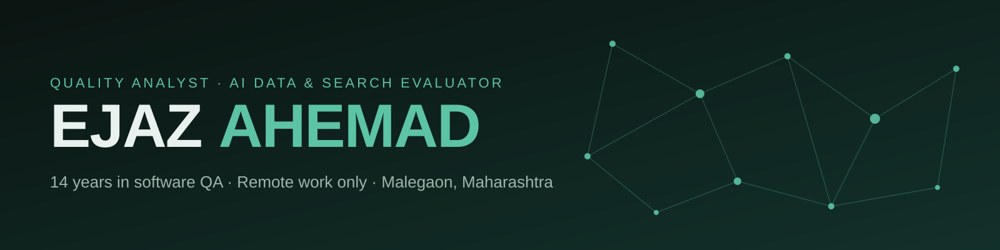

  

  
  
  
  

Hi, I'm Ejaz. I spent 14 years in software quality assurance, testing and signing off releases, and I now work remotely on AI data, language model evaluation and search quality. I live in Malegaon, Maharashtra.

## What I do

**Software quality assurance.** Functional and performance testing, installation checks and defect tracking with Redmine and Mantis, plus test automation in Selenium.

**AI and LLM evaluation.** I rank and judge model responses against written guidelines, write and refine prompts, flag hallucinations, annotate and validate training data, and rate search results and ads.

## Experience

| Period | Role | Where |
| --- | --- | --- |
| Dec 2014 – Jan 2020 | Senior Quality Analyst | Ambab Infotech Pvt. Ltd. |
| Mar 2006 – Sep 2014 | Quality Analyst | Ambab Infotech Pvt. Ltd. |
| Freelance, remote | AI data, LLM and search evaluation | Independent |

## Freelance AI work

- Data Annotation Specialist
- AI Prompt Liaison / Feedback Engineer
- AI Model Trainer
- AI Content Reviewer / Evaluator
- AI Data Validation
- Search Relevance, Search Engine Evaluations, Search Ads Evaluations
- Text and Speech Transcription / Translation
- Dubbing, Lip syncing

## Sample projects

Small browser projects that run without installing anything, built with AI assistance.

| Project | What it is | Demo | Code |
| --- | --- | --- | --- |
| **VLSM Planner** | Splits one IPv4 network into right-sized subnets for the hosts each department needs | [Open](https://ajjuahmad.github.io/vlsm-planner/) | [Repo](https://github.com/ajjuahmad/vlsm-planner) |
| **Packet Trail** | Ping and traceroute simulator that shows how TTL works, hop by hop | [Open](https://ajjuahmad.github.io/packet-trail/) | [Repo](https://github.com/ajjuahmad/packet-trail) |
| **Bug Hunt** | QA game: spot the failing test rows before the timer ends | [Play](https://ajjuahmad.github.io/bug-hunt/) | [Repo](https://github.com/ajjuahmad/bug-hunt) |
| **Port Match** | Memory game: match each protocol with its default port | [Play](https://ajjuahmad.github.io/port-match/) | [Repo](https://github.com/ajjuahmad/port-match) |
| **Relic Run** | Multiplayer co-op dungeon adventure: join with a room code, collect relics, stun guards, escape together | [Play](https://ajjuahmad.github.io/relic-run/) | [Repo](https://github.com/ajjuahmad/relic-run) |
| **Gold Rush** | Multiplayer coin arena: bank coins at your base and dash to steal from rivals | [Play](https://ajjuahmad.github.io/gold-rush/) | [Repo](https://github.com/ajjuahmad/gold-rush) |

## Education

**Bachelor of Engineering, Computer Engineering** (Second Class)
Rizvi College of Engineering, Mumbai, University of Mumbai. August 2002 – May 2006.

Database track: Oracle ERP, Oracle Developer OCM, Oracle DBA, Database Management, MySQL / MS SQL.

## Skills

| Area | What |
| --- | --- |
| QA | QA and testing tools, performance testing, installation, Redmine, Mantis, Selenium |
| AI and LLM | Prompt engineering, LLM optimization, generative AI quality analysis, AI data quality assurance, ML data annotation, response ranking |
| Search | Search engine evaluation, information retrieval analysis, digital advertisement quality |
| Data | Oracle, MySQL / MS SQL, GIS and mapping, data cleaning |
| Working | Communication, leadership, team and project management, planning |

## Languages

- **Native:** English, Hindi, Marathi, Urdu
- **Professional:** Tamil, Gujarati

## Get in touch

Available for **remote work only**. Write to [ajjuahmad4321@gmail.com](mailto:ajjuahmad4321@gmail.com), message me on [LinkedIn](https://www.linkedin.com/in/ajaz-ahmad-a00805425/), or see the full [portfolio](https://ajjuahmad.github.io).
